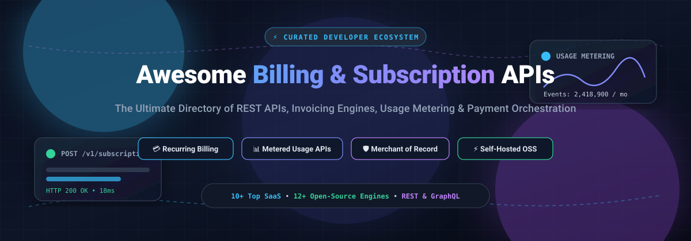

  

# 💳 Awesome Billing & Subscription REST API 🚀

**A curated developer directory of recurring billing engines, subscription management REST APIs, usage-based metering platforms, and self-hosted open-source payment orchestration systems.**

*Explore battle-tested SaaS infrastructure and open-source solutions to power subscription lifecycles, complex multi-tier pricing, metered events, invoices, and compliant global payments.*

---

## 📑 Table of Contents
- [🌐 Sector Overview & Market Dynamics](#-sector-overview--market-dynamics)
- [🏢 SaaS & Hosted Billing APIs](#-saas--hosted-billing-apis)
- [💻 Open-Source GitHub Projects](#-open-source-github-projects)
- [🛠️ SDKs, Tooling & Developer Specifications](#️-sdks-tooling--developer-specifications)
- [📈 Star History](#-star-history)
- [🤝 How to Contribute](#-how-to-contribute)
- [💖 Support & Sponsorship](#-support--sponsorship)
- [⚠️ Disclaimer](#️-disclaimer)

---

## 🌐 Sector Overview & Market Dynamics

The global subscription and billing management software market is valued at approximately **$8 billion to $10 billion**, with projections indicating rapid expansion to **$18 billion–$30 billion** over the next decade at an 11%–15% CAGR. The sector exhibits a **two-tier market structure**:

- **Enterprise Tier (Moderately Concentrated):** Dominated by large-scale quote-to-cash platforms, full-stack payment networks, and enterprise billing monoliths (such as Stripe, PayPal/Braintree, Block/Square, Adyen, and Zuora). These vendors capture high-value enterprise accounts requiring global tax compliance, complex revenue recognition (ASC 606 / IFRS 15), and unified omni-channel payment acquiring.
- **Mid-Market & SME Tier (Highly Fragmented):** Intense competition among agile billing startups, Merchant of Record (MoR) providers, and open-source frameworks (e.g., Lago, Flexprice, OpenMeter, Crater, Invoice Ninja). Developers building modern AI, developer-tooling, and usage-heavy B2B SaaS increasingly turn to decoupled, API-first or self-hosted billing engines to maintain complete data ownership and avoid vendor lock-in.

---

## 🏢 SaaS & Hosted Billing APIs

A comparison of leading hosted subscription engines and payment REST APIs, sorted in descending order by **company scale (valuation / market capitalization)**:

| Platform | Company Scale (Valuation / Revenue) | Starting Pricing Tier | Free Tier Limits / Free Trial Details | Description & Integration Highlights |
| :--- | :--- | :--- | :--- | :--- |
| **[Stripe API](https://docs.stripe.com/api)** | **$159B** private valuation (~$6.8B net revenue) | **0.7%** per recurring charge (Pay-as-you-go) or **$620/month** (up to $100k/mo volume) | **No free tier** for live billing (0.7% fee applies from dollar one); provides unlimited, non-expiring free developer sandbox mode with test API keys and cards. | Predictable resource-oriented RESTful API with official open-source client SDKs for Ruby, Python, PHP, Java, Node.js, Go, and .NET. |
| **[Braintree API](https://developer.paypal.com/braintree/)** *(PayPal)* | **$48B–$63B** market cap of parent PayPal (~$33.2B revenue) | **2.89% + $0.29** per standard transaction (Standard rate) | **No free tier** for live transaction volume; provides an unlimited, perpetual free sandbox environment with real-time subscription lifecycle testing (configurable 1 to 365-day test trials). | Payment processing API featuring GraphQL and REST integrations; webhooks utilize `bt_signature` and `bt_payload` with HMAC-SHA1 validation. |
| **[Square API](https://developer.squareup.com/)** *(Block)* | **$52B–$53B** market cap of parent Block (~$24.5B revenue) | **$0/month** base software fee; **2.9% + $0.30** per transaction for Subscriptions API & Online APIs | **Square Free Plan ($0/month)**: Unlimited subscriptions and invoices created via API with $0 software subscription fees; pay only the 2.9% + $0.30 per successful customer payment, plus unlimited free developer sandbox. | REST API with OAuth 2.0 token management, recurring subscription variations, customer card-on-file handling, and automatic fallback invoicing. |
| **[Adyen API](https://docs.adyen.com/)** | **€27B–€28B (~$28B–$30B)** market cap (~€1.4B net revenue) | **Interchange++ pricing** + **$0.11–$0.13** fixed processing fee per transaction (minimum monthly invoice threshold applies) | **No free tier** for live processing (subject to monthly invoice minimums); provides an unlimited, perpetual free test account with simulated APMs, webhooks, and test-card authorizations. | Enterprise payment platform API offering Open Banking (AISP) endpoints, automated recurring charges, and global multi-acquirer infrastructure. |
| **[Chargebee API](https://apidocs.chargebee.com/)** | **$3.5B** private valuation (~$115M–$200M revenue) | **$0/month** (Starter Plan) or **$599/month** (Performance Plan, covers up to $100k/mo billings) | **$250,000 cumulative lifetime billing limit** free on Starter Plan (0.75% overage fee applies after crossing $250k cap; capped at 50,000 API calls/month). | HTTP Basic Auth REST API with JSON responses providing granular control over subscriptions, usage metering, and customer lifecycles. |
| **[Zuora REST API](https://developer.zuora.com/)** | **$1.7B** acquisition valuation by Silver Lake / GIC (~$450M revenue) | **Annual contract commitments** starting typically at **$75,000+/year** (Launch / Growth editions) | **No public self-serve free tier**; offers sales-provisioned 30-day proof-of-concept evaluation environments and enterprise sandboxes (Developer Sandbox capped at 250,000 records / 50,000 API calls per 24 hours). | Enterprise-scale REST API (v1) covering quote-to-cash, complex multi-entity billing, ASC 606 revenue recognition, and OpenAPI-driven schemas. |
| **[Paddle API](https://developer.paddle.com/)** | **$1.4B** private valuation (~$75M–$90M revenue) | **5% + $0.50** per successful checkout transaction ($0/month base software fee) | **No free tier** for live transaction volume (5% + $0.50 applies starting from the first dollar); offers an unlimited free sandbox environment with dedicated sandbox API keys and simulated checkout. | Merchant-of-Record REST API managing sales tax/VAT remittance, subscriptions, and webhooks with official SDKs (e.g., `paddle-python-sdk`). |
| **[Maxio API](https://developers.maxio.com/)** *(Chargify & SaaSOptics)* | Backed by TA Associates / Vista Equity (~$50M–$100M+ revenue) | **$599/month** (Grow Plan, covers up to $100k/month in billings) | **Maxio Build Plan ($0/month)**: Free non-expiring developer sandbox tier with complete API/SDK access and simulated dummy gateway testing (data purged after 90–120 days of inactivity; no live billing). | Advanced Billing REST API with endpoints for subscription components, usage events, and client-side Maxio.js payment capture. |
| **[Recurly API](https://docs.recurly.com/)** | Backed by Spectrum Equity (~$55M+ revenue) | **$249/month + 0.9%** on monthly billing volume over $40,000 (Starter Plan) | **90-day free trial** of the Starter Plan platform (covers up to $40,000/month in billings during trial before recurring monthly fees kick in). | REST API (v2) for subscription management, dunning workflows, and combined purchase creation endpoints. |
| **[FastSpring API](https://developer.fastspring.com/)** | Acquired by Accel-KKR (~$25M–$50M+ revenue) | **5.9% + $0.95** per transaction (or flat **8.9%** flat-rate digital goods tier, quote-based) | **No free tier** for live transaction processing; provides an unlimited, perpetual free Test Mode account (`.test.onfastspring.com`) with full storefront simulation and test card verification. | Merchant-of-Record REST API with HTTPS/JSON endpoints for software license management, global tax remittance, and subscription lifecycles. |

---

## 💻 Open-Source GitHub Projects

Curated open-source billing engines, metered usage backends, and subscription management platforms for self-hosted and cloud-native deployments. Repositories are sorted in **descending order by GitHub Stars_Count**:

- **[Lago](https://github.com/getlago/lago)**   
  ⚡ *Open-source usage-based billing API and metering platform.* Designed as a developer-first alternative to Chargebee and Stripe Billing, Lago handles high-throughput usage event ingestion, hybrid subscription pricing, custom coupons, credit wallets, localized PDF invoicing, and automated payment orchestration.

- **[Invoice Ninja](https://github.com/invoiceninja/invoiceninja)**   
  🧾 *Self-hosted invoicing, billing, and payment processing suite.* Built with Laravel and Flutter, providing a robust REST API for recurring invoices, automated client payment reminders, quote-to-invoice workflows, and integration with 17+ payment gateways.

- **[Crater](https://github.com/crater-invoice-inc/crater)**   
  📊 *Open-source invoicing solution with full REST API.* Built for freelancers and digital businesses to track expenses, generate detailed recurring invoices, estimate payments, and automate account statements through a sleek Vue & Laravel backend.

- **[Flexprice](https://github.com/flexprice/flexprice)**   
  🏷️ *Usage-based pricing and billing infrastructure for developers.* Features real-time usage metering, credit management, entitlement gating, prepaid wallets, and dynamic pricing models for cloud and AI software applications.

- **[Kill Bill](https://github.com/killbill/killbill)**   
  💰 *Battle-tested enterprise subscription billing and payments platform.* Features a modular Java-based REST architecture supporting hierarchical accounts, complex product catalogs, multi-currency pricing, overdue state machines, dunning, and custom gateway plugins.

- **[Solidus](https://github.com/solidusio/solidus)**   
  🛒 *Open-source eCommerce framework with comprehensive subscription and payment extensions.* Written in Ruby on Rails, offering granular REST & GraphQL interfaces for recurring billing orders, custom checkout lifecycles, and merchant payment routing.

- **[Bigcapital](https://github.com/bigcapitalhq/bigcapital)**   
  📑 *Open-source financial accounting and automated invoicing API.* Provides programmatic endpoints for double-entry bookkeeping, recurring billing, customer balances, and financial health reporting.

- **[OpenMeter](https://github.com/openmeterio/openmeter)**   
  📡 *Cloud-native usage metering and usage-based billing infrastructure.* Ingests millions of real-time events per second via Apache Kafka / ClickHouse to empower AI, cloud, and API developer billing models with low latency.

- **[FOSSBilling](https://github.com/FOSSBilling/FOSSBilling)**   
  🌐 *Free, community-maintained billing and client management software.* Tailored for web hosts, SaaS providers, and cloud service vendors with an extensible modular REST API, ticketing system, and automated recurring billing.

- **[Meteroid](https://github.com/meteroid-oss/meteroid)**   
  📈 *Open-source billing engine for subscription management and usage analytics.* Offers automated billing cycles, cost limit guards, usage-based calculation engines, and customer billing portals.

- **[Tier](https://github.com/tierrun/tier)**   
  🎛️ *Developer tool to manage SaaS pricing, features, and entitlements.* Connects to Stripe to synchronize tier definitions, metered feature flags, and plan configurations from a unified JSON schema.

- **[ServiceBot](https://github.com/service-bot/servicebot)** [?style=social&color=white)](https://github.com/service-bot/servicebot/stargazers)  
  🤖 *Subscription automation and customer management platform.* Provides API endpoints, customer portals, and webhooks to embed recurring subscription checkouts and account management into any application.

- **[BoxBilling](https://github.com/boxbilling/boxbilling)**   
  📦 *Open-source client billing, recurring invoicing, and order management software.* Features a lightweight API for automating customer accounts, order processing, and gateway transactions.

- **[BillaBear](https://github.com/billabear/billabear)**   
  🐻 *Subscription management and automated workflow billing system.* Provides REST API access, state-machine dunning automation, EU reverse charge tax handling, VAT Sense integration, and multi-processor routing.

- **[GOBL (Go Business Language)](https://github.com/invopop/gobl)**   
  📜 *Universal standard and Go library for business documents.* Automates digital invoicing, tax calculation, electronic invoice compliance (Factur-X, PEPPOL), and signature verification.

---

## 🛠️ SDKs, Tooling & Developer Specifications

- **[Stripe OpenAPI Specification](https://github.com/stripe/openapi)**  — Official, machine-readable OpenAPI descriptions for Stripe's complete REST API ecosystem, enabling automated client generation, contract testing, and mock servers.
- **[dj-stripe](https://github.com/dj-stripe/dj-stripe)**  — Production-ready Django models and webhook handlers that sync Stripe recurring billing data natively to SQL databases.
- **[Lago API Client Libraries](https://github.com/getlago)** — Official multi-language SDKs (Python, TypeScript, Go, Ruby) for integrating Lago usage metering and invoicing.
- **[Zuora OpenAPI Specs](https://developer.zuora.com/)** — Standardized REST OpenAPI definitions for Order-to-Cash, dunning workflows, and billing operations.

---

## 📈 Star History

---

## 🤝 How to Contribute

Contributions are warmly welcomed! Help keep this directory comprehensive and up to date:

1. **Fork** the repository.
2. Create a new branch: `git checkout -b add/my-billing-engine`.
3. Add your SaaS or open-source tool to `README.md` following the table or list schema.
4. Ensure descriptions are objective, technical, and accurate.
5. Commit and push your changes: `git push origin add/my-billing-engine`.
6. Submit a **Pull Request** detailing the project's purpose and API architecture.

---

## 💖 Support & Sponsorship

Thank you for exploring and supporting **Awesome Billing & Subscription REST API**! If this repository helped you discover the right billing engine or saved your engineering team development time, consider giving it a ⭐ **Star**, sharing it with fellow developers, or supporting future maintenance:

Every contribution fuels continuous research, documentation updates, and new developer tools for the open-source billing community! ☕

---

## ⚠️ Disclaimer

- This curated collection is for informational and technical reference purposes only. It does not constitute commercial endorsement or financial advice.
- When selecting a billing engine or payment gateway, always evaluate compliance obligations, including **PCI DSS Level 1**, **SCA / PSD2**, **SOC 2 Type II**, and local sales tax/VAT remittance rules.
- Production self-hosted billing engines require rigorous dunning automation, cryptographic audit logging, database backups, and payment reconciliation safeguards.

---

  Built with ❤️ for SaaS engineers, fintech builders, and developer teams worldwide.

